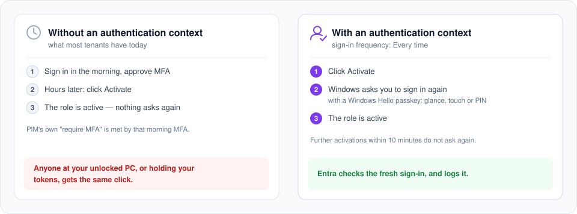

# A fresh sign-in for every activation

**Three settings in the Entra admin center, and every PIM activation asks you to sign in again —
with a passkey in Windows Hello, a glance or a touch.**

You came here from "⚠ This role activates without asking you to sign in again" in Entra PIM Manager.

## Set it up

In this order: the policy has to exist and be on before PIM requires the context. Microsoft's
walkthrough:
[On activation, require Conditional Access authentication context](https://learn.microsoft.com/entra/id-governance/privileged-identity-management/pim-how-to-change-default-settings#on-activation-require-microsoft-entra-conditional-access-authentication-context).

## Answer it with a glance or a touch

- **Microsoft Entra passkey on Windows** keeps a passkey for your admin account in the PC's
  Windows Hello. No device join needed, and it counts as phishing-resistant MFA.
- **Allow it once:** Authentication methods → Passkey (FIDO2), with a passkey profile that permits
  Windows Hello.
- **Register it, per admin and PC:** [Security info](https://mysignins.microsoft.com/security-info)
  → Add sign-in method → Passkey.
  [Microsoft's guide](https://learn.microsoft.com/entra/identity/authentication/how-to-authentication-entra-passkeys-on-windows)

<b>Good to know</b>

- **Why PIM's own MFA setting is not enough.** "On activation, require multifactor
  authentication" checks for an MFA in the session. Microsoft: "Users might not be prompted for
  multifactor authentication if they authenticated with strong credentials or provided
  multifactor authentication earlier in the session"
  ([PIM role settings](https://learn.microsoft.com/entra/id-governance/privileged-identity-management/pim-how-to-change-default-settings#on-activation-require-multifactor-authentication)).
- **Licence.** Every tenant that can use PIM is licensed for this: PIM needs Microsoft Entra ID P2
  or Entra ID Governance, and both come with or require P1, which covers Conditional Access.
- **The app sees the context, not the policy.** After step 3 the hint gives way to "ℹ This
  activation may require additional verification (MFA)". Whether anything is asked depends on the
  policy: switched off or in report-only mode, it asks nobody.
- **Ten minutes.** Entra waives the prompt for further activations within ten minutes, for
  directory roles, PIM for Groups and Azure resource roles alike, so ticking three subscriptions
  asks once.
- **Device-code accounts** cannot satisfy an authentication context. Remove the account and add
  it again with the normal sign-in.
- **Azure resource roles.** For most of them the app cannot read the role's settings with your
  permissions, so it shows no hint either way. The setting applies all the same.
- **Windows Hello for Business.** An account that already has it on that PC uses it instead of a
  passkey.

